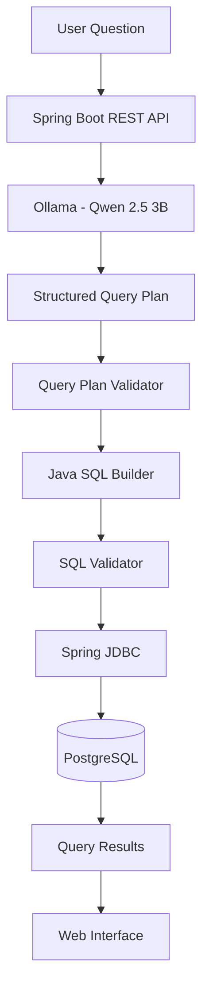

# Cricket SQL Assistant

An AI-powered IPL cricket analytics application that allows users to ask cricket-related questions in natural language and retrieve insights from a PostgreSQL database.

The application uses a locally hosted Large Language Model (LLM) through Ollama to understand user questions and convert them into structured query plans. Java validates these plans and generates parameterised SQL queries before executing them against the database.

## Features

- Natural-language cricket analytics queries.
- Local AI inference using Ollama and Qwen 2.5 3B.
- Structured JSON query-plan generation.
- Query-plan validation using Java.
- Deterministic SQL generation using predefined templates.
- Parameterised SQL execution using Spring JDBC.
- PostgreSQL integration.
- Browser-based interface for submitting questions and viewing results.
- SQL logging for debugging and query transparency.

## Architecture



## Technology Stack

| Technology | Purpose |
|---|---|
| Java | Application development |
| Spring Boot | Backend framework |
| Spring JDBC | Database interaction |
| PostgreSQL | Cricket statistics storage |
| Ollama | Local LLM inference |
| Qwen 2.5 3B | Natural-language understanding |
| HTML, CSS, JavaScript | Frontend |
| Maven | Build management |
| Docker Compose | Database environment |

## How It Works

1. The user submits a cricket question through the web interface.
2. The Spring Boot application sends the question to Ollama.
3. The AI model returns a structured JSON query plan.
4. Java validates the plan against supported operations.
5. The SQL builder generates a predefined, parameterised SQL query.
6. SQL validation checks the generated query.
7. Spring JDBC executes the query against PostgreSQL.
8. The application returns the results to the frontend.

The AI model does not directly generate executable SQL. SQL generation is controlled by Java, making the query execution process more predictable and easier to validate.

## Example Questions

- Which player scored more than 700 runs in a single IPL season?
- How many runs did V Kohli score in the 2026 IPL season?
- Which players scored fewer than 400 runs in a single season?
- Show the top 10 highest-scoring batter seasons.

## Current Query Capabilities

The initial implementation supports:

- Batter run aggregation.
- Season-level statistics.
- Optional player filtering.
- Optional season filtering.
- Greater-than and less-than run comparisons.
- Ascending and descending result sorting.
- Configurable result limits.

Unsupported query types are rejected rather than executed as arbitrary SQL.

## Prerequisites

- Java 27
- PostgreSQL
- Ollama
- Maven (or the included Maven wrapper)
- Cricsheet IPL dataset

## Local Setup

### 1. Clone the repository

```bash
git clone https://github.com/leelakh/cricket-sql-assistant.git
cd cricket-sql-assistant
```

### 2. Start PostgreSQL

Use the supplied Docker Compose configuration:

```bash
docker compose up -d
```

### 3. Install and start Ollama

Install Ollama from:

https://ollama.com/

Download the model:

```bash
ollama pull qwen2.5:3b
```

Ensure the Ollama service is running.

### 4. Configure database credentials

Set the required environment variables:

```bash
export DB_USERNAME="your_database_username"
export DB_PASSWORD="your_database_password"
export CRICSHEET_DIR="/path/to/your/ipl/csv/dataset"
```

Update the database URL if your PostgreSQL configuration differs.

### 5. Download the dataset

Download the IPL dataset from Cricsheet:

https://cricsheet.org/

Place the extracted CSV files in the configured dataset directory.

Follow the application's dataset-loading configuration to populate PostgreSQL.

### 6. Run the application

From the Maven project directory:

```bash
cd cricket-sql
./mvnw spring-boot:run
```

Open the application:

http://localhost:8080

## Project Structure

```text
cricket-sql-assistant/
├── cricket-sql/
│   ├── src/
│   │   ├── main/
│   │   │   ├── java/
│   │   │   │   └── dev/leelakh/cricket_sql/
│   │   │   │       ├── model/
│   │   │   │       ├── rest/
│   │   │   │       ├── service/
│   │   │   │       └── conztraints/
│   │   │   └── resources/
│   │   │       └── static/
│   │   └── test/
│   ├── data/
│   ├── pom.xml
│   └── mvnw
├── db/
│   └── init/
├── docker-compose.yml
└── README.md
```

## Future Enhancements

See the project roadmap for planned capabilities.

## Project Status

This is an evolving personal engineering project exploring practical applications of LLMs, structured AI outputs, deterministic SQL generation and backend validation.

## Data Source

Cricket match data is sourced from Cricsheet. Please refer to Cricsheet's terms and attribution requirements when downloading or redistributing the dataset.

## Author

Developed as a hands-on project exploring AI-assisted analytics using Java and Spring Boot.


